  

    

  
  
  
  

## Featured projects

  
  
  
  

## Tools

  
  
  
  
  
  
  
  
  
  
  

The animations above are hand-made SVGs in <code>assets/</code>, built by <code>assets/src/build.py</code>, with no outside services.
